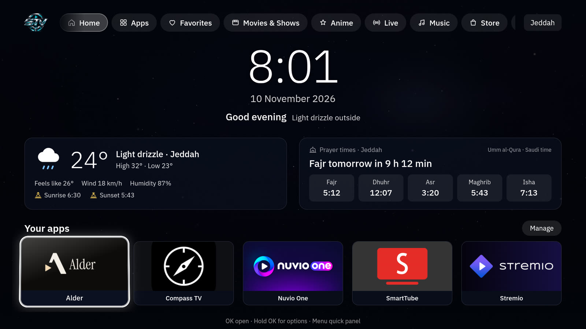
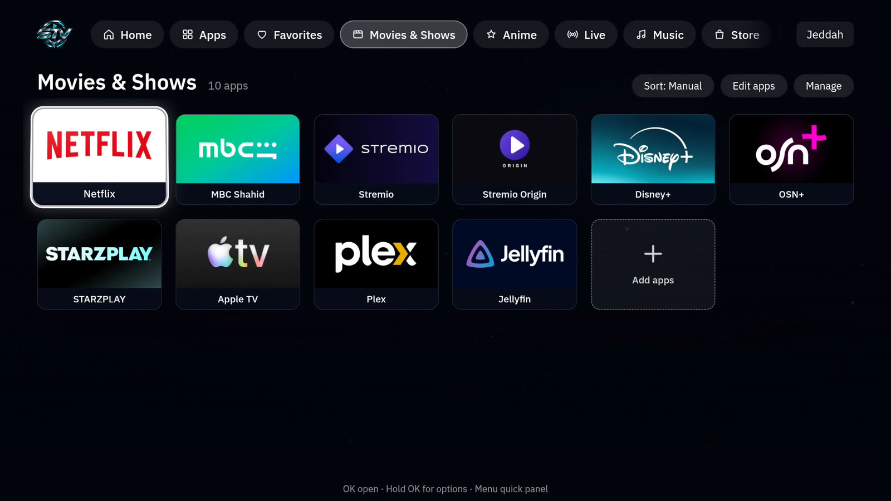
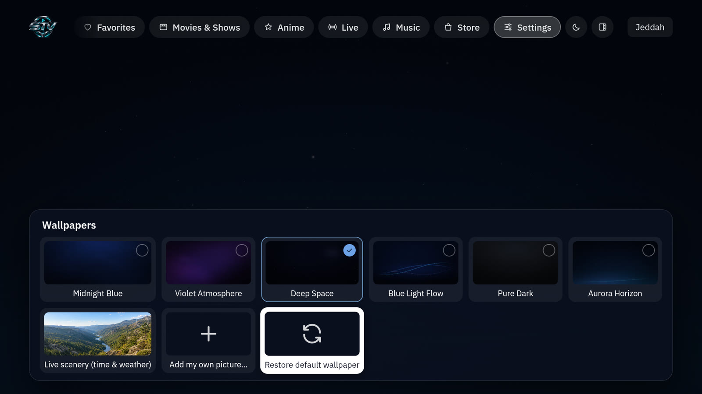
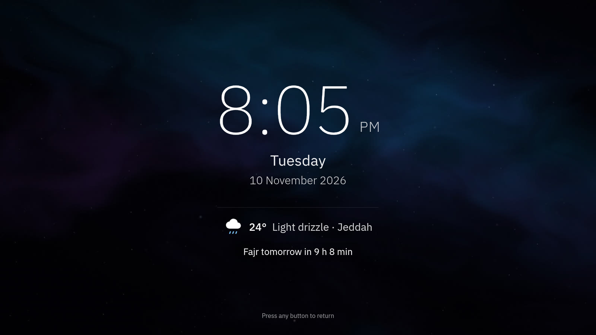
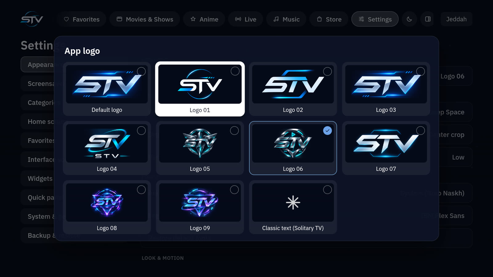
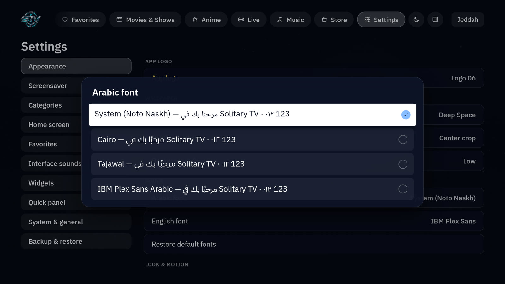
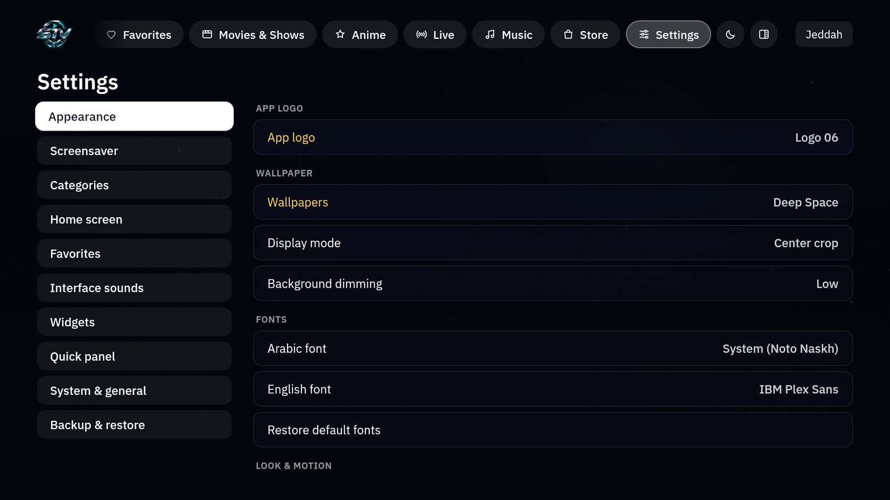
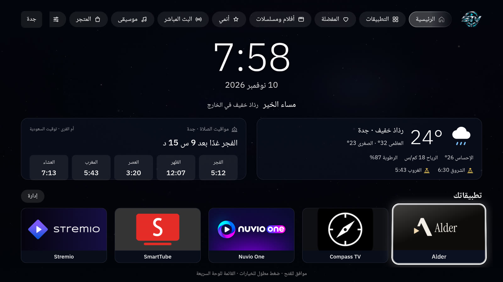

<p align="center">
  
</p>

<h1 align="center">STV</h1>
<p align="center"><b>Your TV. Your Space.</b><br>A customizable home screen for Android TV</p>

<p align="center">
  <a href="https://github.com/Soiltary/STV/releases/latest"><b>Download the APK</b></a> ·
  <a href="https://stv-tools.pages.dev/">Website</a> ·
  <a href="https://stv-tools.pages.dev/#demo">Watch the demo</a> ·
  <a href="README.ar.md">العربية</a>
</p>

---

## Introduction

STV is an Android TV launcher that puts your apps, categories, wallpapers, screensavers and everyday TV controls into one calm,
cinematic interface you drive entirely with the remote. It runs as a normal app next to your current launcher, and you can make it
the Home screen once you are happy with it.

STV was previously called **Solitary TV**. The package name (`tv.customhome.launcher`) and signing key are unchanged, so existing
installs update in place and keep their settings.

## Screenshots

| Home | Categories |
|---|---|
|  |  |
| **Wallpapers** | **Screensaver** |
|  |  |
| **STV logo styles** | **Fonts** |
|  |  |
| **Appearance settings** | **Arabic interface** |
|  |  |

All screenshots are taken from STV 1.5.x running on a real Android TV box.

## Key features

- **Home screen** with a large clock, date and greeting, weather and prayer-time cards, and five home apps you choose.
- **Categories**: Movies & Shows, Anime, Live and Music out of the box. Create, rename, hide and reorder categories, add or remove
  apps, and sort them manually, alphabetically or by recent use.
- **Favorites** page and a full **Apps** page with search.
- **Wallpapers**: built-in dark wallpapers, a live scenery mode that follows the time and weather, or your own picture. Display
  mode and dimming are adjustable.
- **Screensaver**: starts after an idle time you choose (1 to 60 minutes, or never) and shows the clock, day, date, weather and
  next prayer. Several styles, a slideshow of your own pictures, and an Android system screensaver (Daydream) entry.
- **Arabic and English** interface with a full right-to-left layout.
- **Fonts**: pick the Arabic and English fonts independently (Cairo, Tajawal, IBM Plex Sans Arabic, Inter, IBM Plex Sans, or the
  system font).
- **Nine STV logo styles** for the header, plus the classic text logo.
- **Navigation sounds** in four styles (soft, whisper, minimal, cinematic) and three levels, or off.
- **Quick panel** on the Menu button: TV settings, search, all apps, favorites, screensaver, refresh weather and prayer times.
- **Remote first**: every screen works with the D-pad, OK and Back. Hold OK on an app for its options.
- **Backup & restore**: save a backup on the device, export it to Downloads, restore the latest one or restore from a file.
- **Home integration**: a shortcut to the Android screen where you choose the default Home app.

## Supported platforms

STV runs on **Android TV and Google TV devices with Android 8.0 (API 26) or newer**.

It has been tested on one device: an Android 12 TV box (1080p, remote control). Other devices should work, but manufacturers
change how Home and screensavers behave, so try it on yours before making it the Home screen.

## Requirements

- Android TV or Google TV, Android 8.0 or newer
- About 25 MB of free storage
- Internet for weather and prayer times (everything else works offline)
- A way to install an APK: a file manager or downloader app allowed to install unknown apps, or ADB

## Download

**[Download STV for Android TV (latest release)](https://github.com/Soiltary/STV/releases/latest)**

The release page lists the APK, its size and its SHA-256 checksum.

## Installation

1. On the TV, allow your file manager or downloader app to **install unknown apps**
   (usually **Settings → Apps → Special app access → Install unknown apps**; the path varies by device).
2. Download `STV-v1.5.2-AndroidTV.apk` on the TV, or copy it to the TV's `Download` folder.
3. Open the APK from the file manager and choose **Install**.
4. Open STV from the app list. It currently appears as **Solitary TV** (see [Known limitations](#known-limitations)).

With ADB from a computer: `adb install STV-v1.5.2-AndroidTV.apk`

## Set STV as Home

Use STV as a normal app for a while first. When you are ready:

- **From STV**: Settings → System & general → **Choose the default Home app**. This opens the Android screen for the default
  Home app, when your device has one. Select STV there.
- **With ADB**, which also works on devices that hide the Home setting:

  ```bash
  adb shell cmd package set-home-activity tv.customhome.launcher/.MainActivity
  ```

To go back to your previous launcher, select it in the same Android screen, or run the same command with that launcher's
package and activity. Uninstalling STV also returns Home to the system launcher. STV never disables or removes other launchers.

## Customization

Everything lives in **Settings** (the gear in the top bar):

| Tab | What you can change |
|---|---|
| Appearance | App logo, wallpaper, display mode, dimming, Arabic and English fonts, theme, 3D focus effect, animation |
| Screensaver | On/off, start after, style or slideshow, dimming, clock style, 12/24-hour, AM/PM, date, weather, next prayer |
| Categories | Rename, hide, reorder and create categories |
| Home screen | The five apps on the home screen |
| Favorites | Your favorite apps and their order |
| Interface sounds | On/off, style, level, preview |
| Widgets | Clock format, weather card, temperature unit, prayer card, refresh now |
| Quick panel | Menu button behaviour, network info, which tiles are shown |
| System & general | Language, default Home app, Android settings, remote help, version |
| Backup & restore | Save, export, restore |

## Categories & favorites

Open a category from the top bar. **Edit apps** adds or removes apps, **Sort** switches between manual, alphabetical and recently
used, and **Manage** opens the category options. Hold OK on any app to add it to favorites or open its options.

## Wallpapers & screensavers

**Settings → Appearance → Wallpapers** previews each wallpaper as you move through the gallery; OK applies it and Back cancels.
**Add my own picture…** imports a photo from the device, and large images are scaled down automatically.

**Settings → Screensaver** sets the idle time and what is shown. **Preview screensaver** starts it right away. Press any button
to return.

## Language & fonts

**Settings → System & general → Language** switches between English and العربية instantly; the whole layout mirrors for Arabic.
Arabic and English fonts are chosen separately under **Appearance → Fonts**, with a live preview. All bundled fonts use the SIL
Open Font License 1.1.

## Navigation sounds

**Settings → Interface sounds** has four original sound styles and three volume levels. Sounds play only when the focus really
moves, so holding a direction does not stack noise.

## Backup & restore

**Settings → Backup & restore** keeps your categories, favorites, home apps and settings. **Export backup to Downloads** writes a
JSON file you can keep elsewhere, and **Restore from a backup file** brings it back.

## Updating

Download the new APK and install it over the current one. Your settings stay because the package name and signing key do not
change. Do not uninstall first, or the app data is removed.

## Troubleshooting

| Problem | Fix |
|---|---|
| The APK does not install | Allow the file manager to install unknown apps, and check there is enough free space. |
| The Home button still opens the old launcher | Choose STV as the default Home app (see above). Some devices only allow this with ADB. |
| Weather or prayer times are missing | Check the internet connection, then use **Refresh** in the quick panel or under Settings → Widgets. |
| The screensaver does not start | Check **Screensaver → On** and **Start after**. The device's own sleep timer may turn the screen off first. |
| I want my old launcher back | Select it as the default Home app, or uninstall STV. |

## Building from source

Requirements: JDK 17 or newer, the Android SDK (platform 35, build-tools 35), and Node.js 20 or newer for the web tests.

```bash
git clone https://github.com/Soiltary/STV.git
cd STV
./gradlew testSolitaryReleaseUnitTest lintSolitaryRelease assembleSolitaryRelease
node --test web-tests/
```

Without a `signing/signing.properties` file the release APK is built unsigned. Sign it with your own key
(`apksigner sign --ks your.jks app-solitary-release-unsigned.apk`). A build signed with another key cannot update the official
STV install, so uninstall the official build first, or use the `trial` flavor (`tv.customhome.launcher.test`) to install a
development build next to it.

**City for weather and prayer times**: edit `location` (name, latitude, longitude) and `timezone` in
`app/src/main/assets/site/js/config.js`, then build.

## Project structure

```
app/src/main/java/...          Native Android layer: activity, WebView bridge, image library, sounds, screensaver service
app/src/main/assets/site/      The interface (HTML, CSS, JavaScript), wallpapers, logos and bundled fonts
app/src/main/res/raw/          Original interface sounds
web-tests/                     Node tests for the interface logic
scripts/art/                   Generators for the wallpapers, sounds and logo set
scripts/                       Profile and device tools inherited from the upstream project
website/                       The STV website and the promo video build scripts
docs/                          Screenshots and upstream documentation
```

## Known limitations

- **Weather and prayer times are set to Jeddah, Saudi Arabia** (Umm al-Qura method, Riyadh time zone) in the official build.
  There is no city picker in the app yet; other cities need a build from source (see above).
- The Android app label and a few internal strings still say *Solitary TV*. STV is shown in the header logo; the label will be
  renamed in a later version.
- Tested on a single Android 12 device. Home and screensaver behaviour differs between manufacturers.
- On Android 8.0–9 (API 26–28), **Export backup to Downloads** is not available (it needs Android 10); Save backup and
  Restore still work. 1.5.2 fixes a crash risk on those versions that 1.5.1 had. Android 8–9 support is checked by Android
  Lint on CI, not on a real Android 8 or 9 device.
- Weather (Open-Meteo) and prayer times (AlAdhan) depend on those online services.
- Some devices offer no Home setting in the Android UI; ADB is then the only way to make STV the Home screen.

## License

The code is released under the [MIT License](LICENSE). STV builds on
[custom-tv-arabic](https://github.com/TurkiHassan/custom-tv-arabic) by Turki Hassan,
[custom-tv](https://github.com/berteotti/custom-tv) and [CleanYourTV](https://github.com/Gathin23/cleanyourtv), all MIT; their
notices are kept in `LICENSE`, `LICENSE-custom-tv` and `LICENSE-cleanyourtv`. Bundled fonts are under the SIL Open Font
License 1.1. See [THIRD_PARTY_NOTICES.md](THIRD_PARTY_NOTICES.md).

The STV name and logos identify this project. You may use them to refer to STV, but not as the name or logo of a modified build.

## Credits

- Turki Hassan, for custom-tv-arabic, the Arabic Android TV interface STV started from
- The custom-tv and CleanYourTV authors
- Font authors: The Cairo Project Authors, Boutros International (Tajawal), IBM (Plex), The Inter Project Authors
- Weather by [Open-Meteo](https://open-meteo.com/), prayer times by [AlAdhan](https://aladhan.com/)

## Official website

**https://stv-tools.pages.dev/**: overview, demo video, download and installation guide in English and Arabic.
STV is part of the [Syntra](https://syntra-tools.pages.dev/) collection.

## Support

- Bugs and questions: [GitHub Issues](https://github.com/Soiltary/STV/issues)
- Support the project: [tip.dokan.sa/solitary](https://tip.dokan.sa/solitary)
